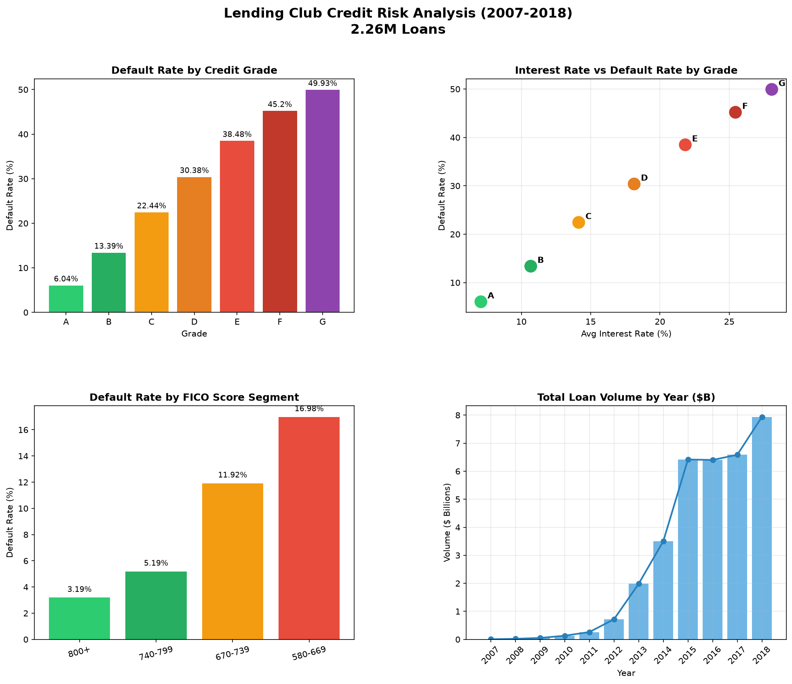

# Credit Risk Analysis — Lending Club (2007–2018)

Exploratory credit risk analysis on **2.26 million personal loans** using PostgreSQL and Python.  
Demonstrates advanced SQL, ETL pipeline design, and business-oriented data storytelling.



---

## Tech Stack

| Layer | Tool |
|-------|------|
| Database | PostgreSQL 17 |
| Connector | SQLAlchemy + psycopg2 |
| Processing | pandas |
| Visualisation | matplotlib |
| Dataset | Lending Club 2007–2018 Q4 · 2.26M rows · 151 columns |

---

## Why PostgreSQL and not pandas directly?

With 2.26 million rows, PostgreSQL runs aggregations on the server without loading everything into RAM. It supports indexes to speed up filters and is the standard in production financial environments. Pandas works well for exploration but doesn't scale to this volume in production.

---

## Project Structure
credit-risk-analysis/
├── load_data.py # Ingests CSV → PostgreSQL (chunked, 2.26M rows)
├── queries.sql # 5 standalone analytical queries
├── dashboard.py # Generates 4-chart matplotlib dashboard
├── dashboard.png # Output visualisation
└── README.md

---

## Advanced SQL Techniques

**CTEs (`WITH grade_summary AS ...`)**  
More readable, easier to debug, and maintainable over time. They allow reusing intermediate results without repeating queries — computing counts once and then calculating the default rate on top, avoiding nested subqueries.

**Conditional aggregation (`COUNT(*) FILTER (WHERE ...)`)**  
Counts Charged Off and Fully Paid in a single pass through the data. This is modern PostgreSQL syntax, more readable than `SUM(CASE WHEN ...)` and better optimised by the query planner.

**Other techniques used:** `RANK() OVER`, `SUM() OVER (PARTITION BY ... ORDER BY ...)`, `LAG() OVER`, `NULLIF`, `CASE` segmentation, regex filtering.

---

## Chart Analysis

### Chart 1 — Default Rate by Credit Grade
Grades A and B are relatively safe with the lowest interest rates. As the grade worsens, default probability rises — but up to Grade D the probability of repayment still exceeds 50%. The inflection point is **Grade E (38.48%)**: from here the investor approaches a coin flip. Grade G reaches **49.93%**.

### Chart 2 — Interest Rate vs Default Rate
A near-perfectly linear relationship: the higher the interest rate, the higher the default rate. The 7 points (A→G) form a straight line, confirming that Lending Club priced its loans accurately — the interest rate faithfully reflects the real risk of each grade.

### Chart 3 — Default Rate by FICO Segment
FICO is an external credit score (800+ exceptional, below 580 high risk). The lower the score, the more defaults. Compared with Chart 1, both Lending Club's internal grade and the external FICO score predict default in the same direction — two independent systems reaching the same conclusion, which validates that the risk is real and not an artefact of the internal model.

### Chart 4 — Total Loan Volume by Year
Explosive growth from 2007 to 2015 driven by low interest rates post-2008 and demand for financing during the crisis. The largest single jump was **2014→2015 (~$3.5B to ~$6.5B)**, coinciding with Lending Club's IPO in December 2014. The 2015–2017 plateau reflects the 2016 internal scandal (CEO resignation) which temporarily caused institutional investors to withdraw capital.

---

## Key Findings

| Metric | Grade A | Grade G |
|--------|---------|---------|
| Default Rate | 6.04% | 49.93% |
| Avg Interest Rate | 7.08% | 28.07% |
| Total Loans | 433,027 | 12,168 |

- A **Grade G borrower defaults ~8× more** than a Grade A borrower.
- **FICO score adds independent signal**: exceptional borrowers (800+) default at 3.19% vs 16.98% for fair borrowers (580–669).
- Platform grew **160× in a decade**: from $0.05B (2007) to $8B (2018).

---

## How to Run

```bash
pip install pandas sqlalchemy psycopg2-binary matplotlib

# Create database
psql -U postgres -c "CREATE DATABASE credit_risk;"

# Load data (download dataset from Kaggle: 'Lending Club Loan Data')
python load_data.py

# Run queries
psql -U postgres -d credit_risk -f queries.sql

# Generate dashboard
python dashboard.py
```

**Dataset:** [Lending Club Loan Data — Kaggle](https://www.kaggle.com/datasets/wordsforthewise/lending-club)

---
